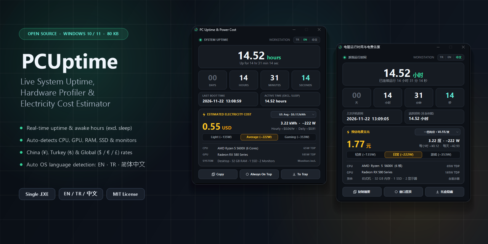
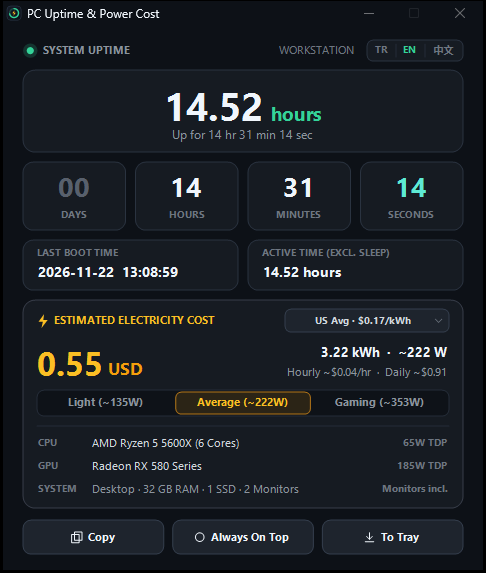

<p align="center">
  
</p>

<h1 align="center">PCUptime</h1>

<p align="center">
  <strong>A tiny (~82 KB), zero-dependency native Windows utility that shows how long your PC has been running, auto-detects your hardware, and estimates your real electricity cost in real time.</strong>
</p>

<p align="center">
  
  
  
  
  <a href="https://linux.do"></a>
</p>

<p align="center">
  <b>English</b> &nbsp;·&nbsp; <a href="README.zh-CN.md"><b>简体中文</b></a> &nbsp;·&nbsp; <a href="#türkçe"><b>Türkçe</b></a> &nbsp;·&nbsp; <a href="https://github.com/rodvay/PCUptime/releases/latest"><b>Download Latest Release</b></a>
</p>

---

## Features

- **Live System Uptime Counter** — Reads Windows kernel counters (`GetTickCount64` + `QueryUnbiasedInterruptTime`) to display total hours, a live `DD : HH : MM : SS` breakdown, exact last boot timestamp, and active awake time excluding sleep/hibernation.
- **Automatic Hardware Detection** — Queries WMI asynchronously at startup (zero UI lag) to identify your **CPU** (model, core count & TDP), **GPU** (discrete vs. integrated & TDP), **Desktop vs. Laptop** form factor, **RAM**, **SSD/HDD count**, and **connected monitors**.
- **Real-Time Electricity Cost Estimation** — Converts detected hardware wattage into realistic wall power draw (factoring in PSU efficiency, platform overhead, and monitor consumption) across three 1-click usage profiles (**Light**, **Average**, **Gaming / Heavy Load**) and estimates total, hourly, and daily electricity cost.
- **China, Turkey & Global Tariff Presets** — Built-in presets for **China State Grid residential tiered rates** (`¥0.55 / ¥0.60 / ¥0.85`), **Turkey EPDK 2026 tax-inclusive tiers** (`3.24 / 4.05 / 4.86 ₺`), and **Global benchmarks** (`US $0.17`, `EU €0.29`, `UK £0.28`), plus custom rate, 5 currencies (`TL`, `CNY`, `USD`, `EUR`, `GBP`), and optional real watt-meter override.
- **Smart OS Language Auto-Detection (`EN` / `TR` / `简体中文`)** — Automatically launches in **Turkish** on Turkish Windows, **Simplified Chinese** on Chinese Windows, and **English** on all other Windows locales — with an instant 1-click **`TR | EN | 中文`** switcher in the top bar.
- **Native Windows 11 Look & Zero Bloat** — Dark immersive title bar (`DwmSetWindowAttribute`), Per-Monitor V2 DPI scaling, ~0% idle CPU usage, Always-On-Top pinning, system tray minimize with live hover tooltip, and 1-click clipboard summary export.
- **Zero Dependencies** — Single portable `.exe` (~82 KB) built directly against the inbox .NET Framework 4.x included with every Windows 10 & 11 machine.

---

## Screenshots

<table>
  <tr>
    <td align="center" width="33.3%">
      <br />
      <sub><b>English UI</b> — US Avg ($0.17/kWh)</sub>
    </td>
    <td align="center" width="33.3%">
      <br />
      <sub><b>简体中文 UI</b> — 中国一档 (¥0.55/度)</sub>
    </td>
    <td align="center" width="33.3%">
      <br />
      <sub><b>Türkçe UI</b> — EPDK 2026 (4,05 ₺/kWh)</sub>
    </td>
  </tr>
</table>

<p align="center">
  <br />
  <sub><b>Tariff & Power Settings</b> — Built-in China, Turkey EPDK 2026 & global presets, 5 currencies, custom kWh rate & watt-meter override</sub>
</p>

---

## Download & Quick Start

1. Go to the **[Releases](https://github.com/rodvay/PCUptime/releases/latest)** page and download **`PCUptime.exe`**.
2. Double-click **`PCUptime.exe`** — no installer, no admin rights, and no extra files required.

> **Note about Windows SmartScreen:** Because `PCUptime.exe` is an independent open-source binary without a paid code-signing certificate, Windows Defender SmartScreen may show a warning on first run. Click **More info → Run anyway**, or inspect the single-file source code (`Program.cs`) and build it yourself in 2 seconds using `build.bat`.

---

## How Power & Cost Estimation Works

PCUptime estimates realistic **wall-outlet power consumption** rather than simply summing peak TDPs:

1. **Component Profiling:** Matches your detected CPU and discrete/integrated GPU against an internal TDP table, adds platform overhead (motherboard, fans, RAM sticks, SSD/HDD drives), accounts for typical PSU efficiency (84%–89%), and optionally adds connected display power (~24–30 W per desktop monitor).
2. **Usage Profiles:**
   | Profile | Typical Workload | Estimated Load Scaling |
   | :--- | :--- | :--- |
   | **Light** | Idle, web browsing, office apps, video playback | Low CPU/GPU utilization |
   | **Average** *(default)* | Daily mixed desktop / multitasking / occasional load | Balanced real-world draw |
   | **Gaming / Heavy** | 3D gaming, rendering, sustained high load | High CPU/GPU sustained load |
3. **Sleep-Aware Energy Math:**
   ```text
   Total kWh = (Awake Hours × Active Watts + Sleep Hours × 4 W) / 1000
   Total Cost = Total kWh × Price per kWh
   ```
   Using `QueryUnbiasedInterruptTime`, sleep/hibernation hours are calculated at standby (~4 W) instead of full active wattage.

### Built-in Electricity Rate Presets

| Region / Tier | Rate | Currency | Notes |
| :--- | :---: | :---: | :--- |
| **China — Tier 1** (`第一档`) | `¥0.55` | `CNY (¥)` | State Grid residential basic tier (national representative, ≤ ~240 kWh/mo) |
| **China — Tier 2** (`第二档`) | `¥0.60` | `CNY (¥)` | State Grid residential mid tier (+¥0.05/kWh) |
| **China — Tier 3** (`第三档`) | `¥0.85` | `CNY (¥)` | State Grid residential high tier (+¥0.30/kWh) |
| **Turkey — Low Tier** (`Düşük`) | `3.24 ₺` | `TL (₺)` | EPDK 2026 residential ≤ 240 kWh/month (tax incl.) |
| **Turkey — Mixed** (`Karma`) | `4.05 ₺` | `TL (₺)` | Midpoint residential household average (tax incl.) |
| **Turkey — High Tier** (`Yüksek`) | `4.86 ₺` | `TL (₺)` | EPDK 2026 residential > 240 kWh/month (tax incl.) |
| **US Average** | `$0.17` | `USD ($)` | National residential benchmark |
| **EU Average** | `€0.29` | `EUR (€)` | European residential benchmark |
| **UK Average** | `£0.28` | `GBP (£)` | UK residential price-cap benchmark |

All settings are persisted cleanly to `%APPDATA%\PCUptime\settings.ini`.

---

## Keyboard Shortcuts

| Shortcut | Action |
| :---: | :--- |
| `Ctrl + C` | Copy formatted uptime, electricity cost & hardware summary to clipboard |
| `T` | Toggle **Always On Top** |
| `H` | Minimize to **System Tray** (left-click tray icon to restore) |
| `L` | Cycle UI language (**TR** → **EN** → **中文**) |

---

## Building from Source

No Visual Studio or external SDK is required — Windows 10 and 11 already include the C# compiler (`csc.exe`) in `.NET Framework 4.x`.

```bat
git clone https://github.com/rodvay/PCUptime.git
cd PCUptime
build.bat
```

---

<a id="türkçe"></a>

## Türkçe Özet

**PCUptime**, bilgisayarınızın kaç saattir açık olduğunu, sistem donanımını (CPU, GPU, RAM, SSD/HDD, monitör sayısı) ve elektrik tarifesine göre tahmini elektrik maliyetini canlı gösteren tek dosyalık (~82 KB) açık kaynak Windows uygulamasıdır.

- **Otomatik Dil Algılama:** Windows diliniz Türkçe ise **Türkçe**, Çince ise **Basitleştirilmiş Çince**, diğer tüm dillerde **İngilizce** olarak açılır; sağ üstteki **`TR | EN | 中文`** seçicisiyle anlık değiştirilebilir.
- **Türkiye EPDK 2026 & Uluslararası Tarifeler:** Türkiye vergiler dahil mesken kademeleri (`3,24 / 4,05 / 4,86 ₺/kWh`), Çin kademeli tarifeleri (`¥0.55 / ¥0.60 / ¥0.85`), ABD/AB/BK tarifeleri ve özel birim fiyat / wattmetre ayarı dahildir.
- **İndirme:** En güncel `PCUptime.exe` dosyasını **[Releases](https://github.com/rodvay/PCUptime/releases/latest)** sayfasından indirebilirsiniz.

> 简体中文完整文档请查看 **[README.zh-CN.md](README.zh-CN.md)**。

---

## Community & Links

- Friendly community link & discussion: **[LINUX DO](https://linux.do)** — Thank you to the LINUX DO open-source community for the feedback and support!

---

## License

This project is licensed under the **MIT License** — see the [LICENSE](LICENSE) file for details.
