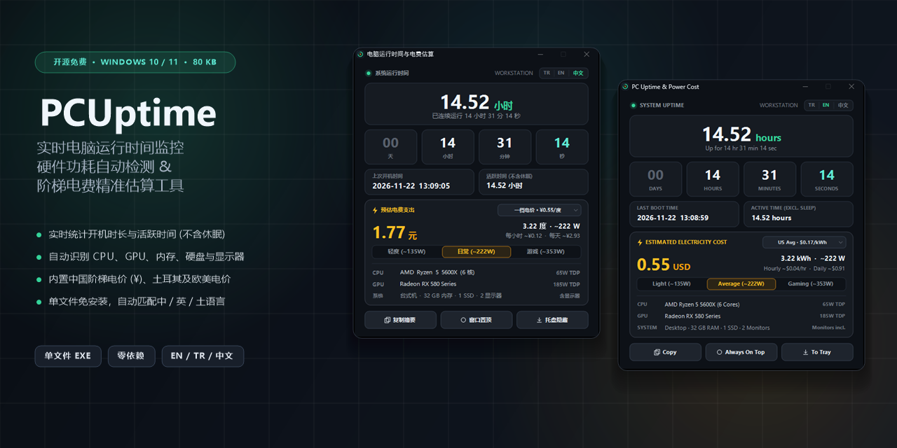
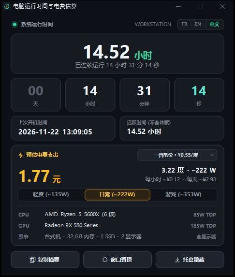
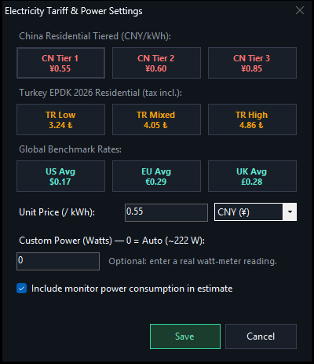

<p align="center">
  
</p>

<h1 align="center">PCUptime — 电脑运行时间与电费估算</h1>

<p align="center">
  <strong>仅约 82 KB、单文件免安装的开源 Windows 桌面小工具：实时查看电脑开机时长、自动识别整机硬件，并结合中国居民阶梯电价实时估算电费支出。</strong>
</p>

<p align="center">
  
  
  
  
</p>

<p align="center">
  <a href="README.md"><b>English</b></a> &nbsp;·&nbsp; <b>简体中文</b> &nbsp;·&nbsp; <a href="README.md#türkçe"><b>Türkçe</b></a> &nbsp;·&nbsp; <a href="https://github.com/rodvay/PCUptime/releases/latest"><b>下载最新版本</b></a>
</p>

---

## 核心功能

- **实时运行时间统计** — 直接调用 Windows 内核计数器（`GetTickCount64` 与 `QueryUnbiasedInterruptTime`），精准展示累计运行小时数、`天 : 小时 : 分钟 : 秒` 实时倒计风格面板、上次开机时间，以及**不含休眠/睡眠的真实活跃时长**。
- **自动识别整机硬件** — 启动时异步读取 WMI 硬件信息（零卡顿），自动识别 **CPU 型号/核心数与 TDP**、**独立/核显 GPU 与 TDP**、**台式机/笔记本类型**、**内存容量**、**SSD/HDD 硬盘数量**以及**外接显示器数量**。
- **贴近真实插座功耗的电费估算** — 综合电源转换效率（84%–89%）、主板/风扇/内存/硬盘基础功耗及显示器功耗，提供 **轻度 / 日常 / 游戏** 三档一键切换，并实时显示总耗电量（度/kWh）、总电费、每小时及每天预估开销。
- **内置中国居民阶梯电价与全球电价** — 预设国家电网代表性居民阶梯电价（**第一档 ¥0.55 / 第二档 ¥0.60 / 第三档 ¥0.85**）、土耳其 EPDK 2026 电价及美/欧/英基准电价，支持 **人民币 (¥)、土耳其里拉 (₺)、美元 ($)、欧元 (€)、英镑 (£)** 五种货币，并可手动填入您所在省市的实际电价（如北京 `0.49`、上海 `0.62`）或功率计实测瓦数。
- **系统语言智能自动适配** — 首次启动自动识别 Windows 系统语言：中文系统自动以**简体中文 + 人民币阶梯电价**启动，土耳其语系统自动以土耳其语启动，其余系统默认英文；也可通过右上角 **`TR | EN | 中文`** 一键切换。
- **原生 Windows 11 深色体验** — 支持深色标题栏、多显示器 Per-Monitor V2 高分屏缩放、空闲近 0% CPU 占用、窗口置顶、系统托盘隐藏（悬停显示运行时间与电费）以及一键复制完整摘要。

---

## 界面预览

<table>
  <tr>
    <td align="center" width="50%">
      <br />
      <sub><b>简体中文主界面</b> — 中国居民一档电价 (¥0.55/度)</sub>
    </td>
    <td align="center" width="50%">
      <br />
      <sub><b>电价与功耗设置</b> — 内置中国一/二/三档、土耳其及全球电价预设</sub>
    </td>
  </tr>
</table>

---

## 下载与使用

1. 前往 **[Releases 发布页](https://github.com/rodvay/PCUptime/releases/latest)** 下载 **`PCUptime.exe`**（仅约 82 KB）。
2. 双击直接运行，无需安装、无需管理员权限、不依赖任何额外 DLL。

> **关于 Windows SmartScreen 提示：** 由于开源项目未购买商业代码签名证书，首次运行时 Windows 可能会弹出“Windows 已保护你的电脑”提示。点击 **更多信息 → 仍要运行** 即可，或者直接查看单文件源码 [Program.cs](Program.cs) 并双击 `build.bat` 自行编译。

---

## 功耗与电费计算说明

1. **休眠感知电费公式：**
   ```text
   总耗电量 (度/kWh) = (活跃小时数 × 整机估算瓦数 + 休眠小时数 × 4 W) / 1000
   预估电费 = 总耗电量 × 电价单价
   ```
   休眠/睡眠期间按约 `4 W` 待机功耗计入，不会把整夜休眠按满载算钱。

2. **内置电价参考表：**

| 地区 / 档位 | 默认单价 | 货币 | 说明 |
| :--- | :---: | :---: | :--- |
| **中国 — 第一档** | `¥0.55` | `CNY (¥)` | 居民基本用电档（全国代表均价，约 ≤ 240 度/月） |
| **中国 — 第二档** | `¥0.60` | `CNY (¥)` | 居民进阶档（较一档 +0.05 元/度） |
| **中国 — 第三档** | `¥0.85` | `CNY (¥)` | 居民高耗档（较一档 +0.30 元/度） |
| **土耳其 — 低/均/高档** | `3.24 / 4.05 / 4.86 ₺` | `TL (₺)` | 土耳其 EPDK 2026 含税居民阶梯电价 |
| **美国 / 欧盟 / 英国均价** | `$0.17 / €0.29 / £0.28` | `USD / EUR / GBP` | 国际居民电价参考 |

> 注：中国各省市居民阶梯电价略有差异（如北京一档约 `¥0.49`、上海约 `¥0.62`、广东约 `¥0.59`），点击主界面电价标签即可自定义为您当地的实际电价并自动保存至 `%APPDATA%\PCUptime\settings.ini`。

---

## 快捷键

| 快捷键 | 功能 |
| :---: | :--- |
| `Ctrl + C` | 复制运行时间、电费与硬件配置摘要到剪贴板 |
| `T` | 切换**窗口置顶** |
| `H` | 隐藏至**系统托盘**（单击托盘图标恢复） |
| `L` | 切换界面语言（**TR** → **EN** → **中文**） |

---

## 从源码编译

无需安装 Visual Studio，Windows 10 / 11 系统自带 `.NET Framework 4.x` 编译器（`csc.exe`）：

```bat
git clone https://github.com/rodvay/PCUptime.git
cd PCUptime
build.bat
```

## 开源协议

本项目基于 **MIT License** 开源 — 详情见 [LICENSE](LICENSE)。
